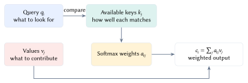
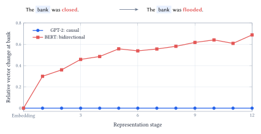
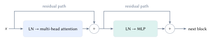

::: {.lecture-note-actions role="navigation" aria-label="Lecture note navigation"}
[Course materials](../lectures/14-transformers.qmd){.btn .btn-primary .btn-sm}
:::

::: {.callout-note appearance="simple"}
**Learning goals.** Explain queries, keys, and values; calculate an attention-weighted output; distinguish information access, training, and generation.
:::

## Why a word needs its context

"The man bites the dog" and "The dog bites the man" use the same words, but assign different roles. "Bank" can refer to a financial institution or the side of a river. A useful representation must account for the sequence, not just the presence of individual words.

Tokenization first converts text into discrete IDs. A token can be a word, a fragment, punctuation, or a word with a leading space. An embedding maps each ID to a vector. GPT-2 adds a learned position vector, so the initial representation records both token identity and position.

Attention then gives positions a way to exchange information. For a target position, a *query* describes what information to look for. Every available position supplies a *key* for matching and a *value* to contribute. These are learned numerical projections, not human-written descriptions of word meanings. <figure id="figure-1" class="lecture-14-figure">
<a href="../assets/lecture-notes/lecture-14/lookup.svg" target="_blank" rel="noopener" aria-label="Enlarge Figure 1"><picture><source media="(max-width: 600px)" srcset="../assets/lecture-notes/lecture-14/lookup-mobile.svg" width="182.778" height="148.417"></picture></a>
<figcaption>Figure 1. A query is compared with available keys. The resulting weights combine the corresponding values. This diagram explains the operation; it does not claim that any real head has a fixed linguistic role. <a class="figure-enlarge" href="../assets/lecture-notes/lecture-14/lookup.svg" target="_blank" rel="noopener" aria-label="Enlarge Figure 1">Enlarge</a></figcaption>
</figure>

## From matching scores to a weighted sum

The whiteboard sentence about an animal being too tired to cross a street motivates a useful lookup: the pronoun may need information about the animal. That is an interpretation of the sentence, not a measured attention pattern. To examine a trained model, the notebook uses GPT-2 and records its actual vectors, weights, and predictions.

Let $X\in\mathbb{R}^{T\times d}$ contain the incoming representations for $T$ tokens. One attention head learns three projection matrices:

$$
Q=XW_Q,\qquad K=XW_K,\qquad V=XW_V.
$$

 Queries and keys have width $d_k$; values have width $d_v$. The compatibility between query $i$ and key $j$ becomes

$$
s_{ij}=\frac{q_i^\top k_j}{\sqrt{d_k}}+M_{ij},\qquad
 a_{ij}=\frac{e^{s_{ij}}}{\sum_{\ell}e^{s_{i\ell}}}.
$$

 Softmax acts across the available keys for each query. Its weights are nonnegative and sum to one. Dividing by $\sqrt{d_k}$ controls the growth in dot-product scale with dimension; it is not cosine normalization.

The output is a weighted mixture of *values*:

$$
c_i=\sum_j a_{ij}v_j,\qquad
 C=\operatorname{softmax}\!\left(\frac{QK^\top}{\sqrt{d_k}}+M\right)V.
$$

 For a small illustrative calculation, suppose one query has two scores $(\log 3,0)$. Softmax gives weights $(3/4,1/4)$. If the values are $(2,-1)$ and $(0,3)$, then

$$
c=\tfrac34(2,-1)+\tfrac14(0,3)=(1.5,0).
$$

 The second coordinate cancels even though both weights are positive. A value coordinate is a signed number; an attention weight is not a percentage of a word's meaning.

In the notebook, the same calculation is performed with one actual GPT-2 head: layer index 5, head index 2, with six input tokens and 64 value coordinates. The three essential operations are

    scores = Q @ K.T / math.sqrt(d_k)
    scores = scores.masked_fill(future_mask, -torch.inf)
    weights = scores.softmax(-1)
    context = weights @ V

The reconstructed 64-dimensional output matches the model's saved head output; the recorded maximum difference is zero at the displayed precision. Future weights are zero and every row sums to one. The illustrated three-coordinate slice is only a view into that full calculation.

Training learns $W_Q,W_K,W_V$. The attention weights $A$ are calculated afresh from each input. Confusing these two kinds of weights obscures what attention learns and what changes at inference time.

## Which words are allowed to contribute?

For causal attention, $M_{ij}=0$ when $j\leq i$ and $M_{ij}=-\infty$ when $j>i$. A token can use itself and earlier positions, but not later ones. The restriction applies at every block.

The notebook compares "The bank was closed" with "The bank was flooded." Only the later word changes; the token *bank* keeps the same identity and position. Its GPT-2 representation is identical at every stage. BERT uses bidirectional attention, so its representation can change. <figure id="figure-2" class="lecture-14-figure">
<a href="../assets/lecture-notes/lecture-14/context-access.svg" target="_blank" rel="noopener" aria-label="Enlarge Figure 2"><picture><source media="(max-width: 600px)" srcset="../assets/lecture-notes/lecture-14/context-access-mobile.svg" width="227.638" height="170.787"></picture></a>
<figcaption>Figure 2. Measured changes to the representation of bank after replacing the later word closed with flooded. GPT-2 stays at zero; BERT changes. The curves use complete hidden vectors, not a two-dimensional projection. <a class="figure-enlarge" href="../assets/lecture-notes/lecture-14/context-access.svg" target="_blank" rel="noopener" aria-label="Enlarge Figure 2">Enlarge</a></figcaption>
</figure>

The vertical axis is a within-model relative change,

$$
\Delta=\frac{\|h_A-h_B\|_2}{(\|h_A\|_2+\|h_B\|_2)/2}.
$$

 A larger value is not an accuracy score or proof of better understanding. This experiment tests information access. The unchanged starting vectors confirm that the target token and its position stayed fixed.

Now change the *earlier* context: "He deposited money at the bank" versus "He watched ducks at the bank." GPT-2 starts with the same embedding for the final token, then produces different final representations (relative change about 0.138) and different next-token distributions. The causal mask permits that earlier context to reach the target.

Without position information, unrestricted self-attention is equivariant to a permutation of its inputs: it follows the reordered vectors rather than supplying an intrinsic word order. GPT-2 combines learned position embeddings with causal access. Standard BERT instead learns a masked-token objective with access to both sides.

## From attention heads to a language model

Multiple heads use separate learned projections. Their outputs are concatenated and projected back to the model width. GPT-2 combines 12 heads of 64 coordinates each. Heads are not independent classifiers voting on a word.

Different attention patterns do not establish fixed linguistic roles or causal importance to the final prediction.

<figure id="figure-3" class="lecture-14-figure">
<a href="../assets/lecture-notes/lecture-14/block.svg" target="_blank" rel="noopener" aria-label="Enlarge Figure 3"><picture><source media="(max-width: 600px)" srcset="../assets/lecture-notes/lecture-14/block-mobile.svg" width="172.588" height="243.869"></picture></a>
<figcaption>Figure 3. A GPT-2 block mixes information across positions with attention, then transforms each position with an MLP. Residual additions preserve a path for the incoming representation. LN denotes layer normalization. <a class="figure-enlarge" href="../assets/lecture-notes/lecture-14/block.svg" target="_blank" rel="noopener" aria-label="Enlarge Figure 3">Enlarge</a></figcaption>
</figure>

The MLP shares parameters across positions within a block; different blocks have different parameters. All these paths jointly determine the next representation.

## Training predicts recorded tokens; generation extends them

A final normalization and vocabulary projection produce logits. Softmax gives a distribution over 50,257 possible next tokens, not a probability that a statement is true.

For recorded tokens $x_1,\ldots,x_T$, next-token training minimizes

$$
L=-\frac{1}{T-1}\sum_{t=1}^{T-1}\log p_\theta(x_{t+1}\mid x_{1:t}).
$$

 The notebook aligns `logits[:, :-1]` with `input_ids[:, 1:]`. All recorded prefixes are available, so causal attention can compute these predictions in parallel. Backpropagation trains the projection matrices without labels specifying which token a head should attend to.

During ordinary autoregressive generation, a selected token is appended before the next prediction. For the money prompt, the saved greedy run selects *bank* at about 23% probability, then a comma, then *but*. A top-ranked token need not have high probability; greedy decoding does not optimize the whole sequence.

[Vaswani et al., Attention Is All You Need](https://arxiv.org/abs/1706.03762) and [Devlin et al., BERT](https://aclanthology.org/N19-1423/) provide the architectural and training context. **Acknowledgment.** These notes are based on the instructor's handwritten notes and transcripts of lecture discussions and were editorially polished and typeset with assistance from OpenAI Codex and Anthropic Claude. The instructor reviewed and is responsible for the final content.

**In one sentence:** Attention learns input-dependent mixtures of value vectors, while position information, masks, and the training objective determine how those mixtures support sequence prediction.
