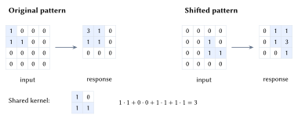
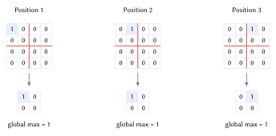
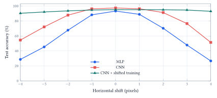
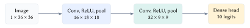

::: {.lecture-note-actions role="navigation" aria-label="Lecture note navigation"}
[Course materials](../lectures/15-cnn.qmd){.btn .btn-primary .btn-sm}
:::

::: {.callout-note appearance="simple"}
**Learning goals.** Compute a local filter response; distinguish equivariance from invariance; use controlled shifts to evaluate the architecture and its training data.
:::

## Recognize the pattern wherever it appears

A digit can move without changing its label. A dense network can learn spatial relationships, but does not build in local connections or shared detectors. Flattening preserves the pixel values; the missing ingredient is an architectural preference for reusing local patterns.

Convolution applies the same small filter at many locations. For one channel, stride one, and no padding,

$$
z_{ij}=\sum_{u=0}^{k_h-1}\sum_{v=0}^{k_w-1}K_{uv}I_{i+u,j+v}+b.
$$

 The patch moves; the weights stay shared. Here a $2\times2$ filter detects an L-shaped pattern: <figure id="figure-1" class="lecture-15-figure">
<a href="../assets/lecture-notes/lecture-15/sliding.svg" target="_blank" rel="noopener" aria-label="Enlarge Figure 1"><picture><source media="(max-width: 600px)" srcset="../assets/lecture-notes/lecture-15/sliding-mobile.svg" width="158.338" height="255.546"></picture></a>
<figcaption>Figure 1. The same hand-chosen filter produces a maximum of 3 at two different locations. Stride is one; padding and bias are zero. This unflipped operation is cross-correlation. <a class="figure-enlarge" href="../assets/lecture-notes/lecture-15/sliding.svg" target="_blank" rel="noopener" aria-label="Enlarge Figure 1">Enlarge</a></figcaption>
</figure>

## Equivariance and invariance

For a stride-one filter away from image boundaries, translating the input translates the feature map:

$$
F(T_\delta I)=T_\delta F(I).
$$

 This is *translation equivariance*. Invariance would instead require $F(T_\delta I)=F(I)$. A convolution alone does not make its output unchanged.

Pooling summarizes responses. Max pooling retains the largest value in a window; average pooling retains its mean. Local pooling can ignore a small movement inside one window, but a movement across the window boundary can change the result. <figure id="figure-2" class="lecture-15-figure">
<a href="../assets/lecture-notes/lecture-15/pooling.svg" target="_blank" rel="noopener" aria-label="Enlarge Figure 2"><picture><source media="(max-width: 600px)" srcset="../assets/lecture-notes/lecture-15/pooling-mobile.svg" width="158.905" height="312.321"></picture></a>
<figcaption>Figure 2. Three conceptual feature maps contain the same single response. A one-pixel move within a pooling window leaves the local pooled result unchanged; crossing the boundary changes it. Global max returns 1 in all three cases and discards the location. <a class="figure-enlarge" href="../assets/lecture-notes/lecture-15/pooling.svg" target="_blank" rel="noopener" aria-label="Enlarge Figure 2">Enlarge</a></figcaption>
</figure>

Global pooling summarizes the entire feature map. It is invariant to rearranging the entries of that fixed map. An entire CNN can still be shift-sensitive: cropping, padding, strides, and earlier operations may change the values that reach pooling. A location-specific classifier can add further sensitivity.

## Why sharing saves parameters

A standard dense convolution with $C_{\mathrm{in}}$ input channels and $C_{\mathrm{out}}$ output channels has

$$
C_{\mathrm{out}}(C_{\mathrm{in}}k_hk_w+1)
$$

 parameters when each output channel has a bias. The count does not grow with image height or width, although computation and stored activations do.

Each output channel has a kernel spanning *all* input channels. For example, `nn.Conv2d(16, 32, 3, padding=1)` learns $32(16\cdot3\cdot3+1)=4{,}640$ parameters. It combines local patterns from 16 incoming maps into 32 new maps.

Repeated convolutions expand the receptive field. Two $3\times3$ stride-one layers see a $5\times5$ input region, provided no stride or dilation changes intervene. Nonlinearities between layers allow richer compositions than one linear filter.

## Does the trained model tolerate a moving digit?

The notebook places each $28\times28$ MNIST digit on a $36\times36$ black canvas. Shifts from $-4$ to $+4$ pixels preserve every original pixel. Padding occurs before normalization, so the added background is truly black.

An MLP and a small CNN train on the same 12,000 centered digits for five epochs, using the same batch order, optimizer, and learning rate. A separate 2,000-image validation set informs the fixed setup. The models have 167,306 and 171,402 parameters respectively. Similar parameter counts do not imply equal compute or optimal tuning.

A third model keeps the CNN architecture and initial weights but receives random horizontal and vertical training shifts. This changes the positions seen during learning, not the number of labeled images or updates. <figure id="figure-3" class="lecture-15-figure">
<a href="../assets/lecture-notes/lecture-15/shift.svg" target="_blank" rel="noopener" aria-label="Enlarge Figure 3"><picture><source media="(max-width: 600px)" srcset="../assets/lecture-notes/lecture-15/shift-mobile.svg" width="227.625" height="167.414"></picture></a>
<figcaption>Figure 3. Measured accuracy on the same 10,000 held-out MNIST test digits at each horizontal shift. The centered CNN improves on the MLP, but both lose accuracy as the digits move. Shift augmentation substantially improves stability in this saved seeded run. <a class="figure-enlarge" href="../assets/lecture-notes/lecture-15/shift.svg" target="_blank" rel="noopener" aria-label="Enlarge Figure 3">Enlarge</a></figcaption>
</figure>

At the center, the MLP makes 670 errors and the CNN 255. Yet at a four-pixel shift to the right, their accuracies fall to about 26.6% and 51.4%. The augmented CNN reaches 93.0% there, compared with 95.2% at the center.

The architecture helps, but does not supply all the desired behavior automatically. Training on varied positions makes a large difference, with a modest centered-accuracy trade-off at this budget. These results concern horizontal shifts on MNIST; they do not establish robustness to rotation, blur, or every image transformation.

## From local responses to class scores

The small CNN applies two convolution--ReLU--pool blocks. Its spatial sizes go from $36\times36$ to $18\times18$ to $9\times9$, then a fully connected head produces ten class logits. The kernels and the head learn together from cross-entropy. <figure id="figure-4" class="lecture-15-figure">
<a href="../assets/lecture-notes/lecture-15/pipeline.svg" target="_blank" rel="noopener" aria-label="Enlarge Figure 4"><picture><source media="(max-width: 600px)" srcset="../assets/lecture-notes/lecture-15/pipeline-mobile.svg" width="108.215" height="210.779"></picture></a>
<figcaption>Figure 4. Spatial resolution decreases while the number of channels grows. The second convolution combines responses from the first, and a learned readout maps the resulting features to digit scores. <a class="figure-enlarge" href="../assets/lecture-notes/lecture-15/pipeline.svg" target="_blank" rel="noopener" aria-label="Enlarge Figure 4">Enlarge</a></figcaption>
</figure>

AlexNet popularized this broad pattern at ImageNet scale with five convolutional layers and three fully connected layers. Modern architectures can be much deeper and add residual connections, but local filters and shared parameters remain central.

The notebook shows a pretrained ResNet-50's responses to one dog photograph. Early and later maps provide views of the computation at different spatial scales. A map activated around an ear does not by itself establish a general-purpose "ear detector." Channels were selected for high spatial variance on that image, and color scales differ between layers.

## A visualization is evidence to investigate

A gradient with respect to the input asks how a class score changes under tiny pixel perturbations. An occlusion experiment instead covers a visible region and measures the score again. These answer different questions.

For the notebook's Samoyed logit, covering an $80\times80$ head region with the ImageNet mean color lowers the score by about 2.19. Covering an equally sized body region raises it by about 2.17. The regions were chosen by their image locations, not searched for a maximum effect. Covering also introduces an artificial patch, so it is not a pure deletion of semantic evidence.

A bright gradient is not a share of the model's reasoning, and a high softmax probability does not guarantee correctness. Inspect learned features, then test the behavior you actually need on appropriate held-out examples.

[Dumoulin and Visin, convolution arithmetic](https://arxiv.org/abs/1603.07285) explains filter geometry; [Zhang, shift invariance](https://proceedings.mlr.press/v97/zhang19a.html) examines the effects of downsampling. **Acknowledgment.** These notes are based on the instructor's handwritten notes and transcripts of lecture discussions and were editorially polished and typeset with assistance from OpenAI Codex and Anthropic Claude. The instructor reviewed and is responsible for the final content.

**In one sentence:** Convolution reuses local patterns efficiently, while pooling, the readout, and the positions seen during training determine how that efficiency translates into stable predictions.
