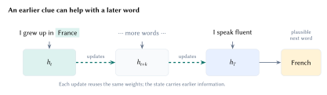
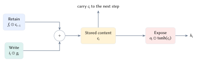
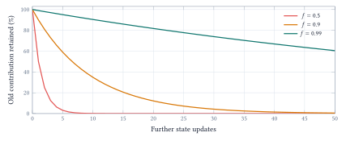
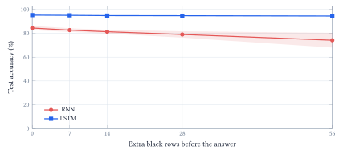

::: {.lecture-note-actions role="navigation" aria-label="Lecture note navigation"}
[Course materials](../lectures/16-rnn.qmd){.btn .btn-primary .btn-sm}
:::

::: {.callout-note appearance="simple"}
**Learning goals.** Trace a recurrent state update; explain how LSTM gates control memory; compare retention and storage in recurrent models and attention.
:::

## Carry a summary from one input to the next

A sequence model may need an earlier clue to interpret a later input: "I grew up in France ... I speak fluent ..." motivates retaining information over a gap. A recurrent neural network processes each new input together with its previous hidden state.

For input $x_t\in\mathbb{R}^{d}$ and state $h_t\in\mathbb{R}^{H}$,

$$
h_t=\tanh(W_{xh}x_t+W_{hh}h_{t-1}+b).
$$

 Here $W_{xh}\in\mathbb{R}^{H\times d}$, $W_{hh}\in\mathbb{R}^{H\times H}$, and $b\in\mathbb{R}^{H}$. The same parameters are reused at every time step; the input and the state change. Doubling sequence length doubles the number of updates, not the parameter count or state width. <figure id="figure-1" class="lecture-16-figure">
<a href="../assets/lecture-notes/lecture-16/unroll.svg" target="_blank" rel="noopener" aria-label="Enlarge Figure 1"><picture><source media="(max-width: 600px)" srcset="../assets/lecture-notes/lecture-16/unroll-mobile.svg" width="129.692" height="239.217"></picture></a>
<figcaption>Figure 1. Unrolling exposes repeated applications of the same state update. Earlier information can affect the final prediction only through the intermediate states. The boxes share parameters. <a class="figure-enlarge" href="../assets/lecture-notes/lecture-16/unroll.svg" target="_blank" rel="noopener" aria-label="Enlarge Figure 1">Enlarge</a></figcaption>
</figure>

The classifier reads only the final hidden state. PyTorch's recurrent module returns this state directly; `self.readout(h[-1])` selects the last recurrent layer's final state and maps it to ten logits. It does not concatenate every past state. The notebook also repeats the recurrence by hand and checks that it matches `nn.RNN`.

## Retain, write, and expose information separately

An LSTM carries a cell state $c_t$ as well as a hidden state $h_t$. The cell holds content; the hidden state exposes a gated view used by the next update and the readout. Calling them "long-term" and "short-term" memory is a useful mnemonic, not a guarantee about their actual time scales.

Let $u_t=[h_{t-1};x_t]$ concatenate the previous hidden state and new input. Three learned gates and a candidate vector are

$$
\begin{aligned}
f_t&=\sigma(W_fu_t+b_f),& i_t&=\sigma(W_iu_t+b_i),\\
o_t&=\sigma(W_ou_t+b_o),& g_t&=\tanh(W_gu_t+b_g).
\end{aligned}
$$

 Sigmoid gates choose a separate value between zero and one for each coordinate. They are continuous, not binary switches, and they do not sum to one across coordinates. The candidate $g_t$ supplies signed new content.

$$
\boxed{c_t=f_t\odot c_{t-1}+i_t\odot g_t},\qquad
 h_t=o_t\odot\tanh(c_t).
$$

 <figure id="figure-2" class="lecture-16-figure">
<a href="../assets/lecture-notes/lecture-16/gates.svg" target="_blank" rel="noopener" aria-label="Enlarge Figure 2"><picture><source media="(max-width: 600px)" srcset="../assets/lecture-notes/lecture-16/gates-mobile.svg" width="185.883" height="243.094"></picture></a>
<figcaption>Figure 2. The forget gate scales only the old content, while the input gate scales new writing. The output gate controls the exposed hidden state. Hiding the output does not erase the stored cell state. <a class="figure-enlarge" href="../assets/lecture-notes/lecture-16/gates.svg" target="_blank" rel="noopener" aria-label="Enlarge Figure 2">Enlarge</a></figcaption>
</figure>

For the notebook's illustrative scalar values, $c_{t-1}=0.8$, $f_t=0.9$, $i_t=0.2$, $g_t=-0.5$, and $o_t=0.75$:

$$
c_t=0.9(0.8)+0.2(-0.5)=0.62,\qquad
h_t=0.75\tanh(0.62)\approx0.413.
$$

 These numbers are chosen to explain the mechanism, not recorded gates from a trained digit model. To replace old content, the forget gate can approach zero while the input gate remains open. To retain content without exposing it, the output gate can approach zero without changing $c_t$.

Putting the output gate inside $\tanh$ changes the mechanism. With $c_t=10$ and $o_t=0.1$, $o_t\tanh(c_t)\approx0.10$, whereas $\tanh(o_tc_t)\approx0.76$. Controlling a share of the bounded output is different from shrinking the input to a saturating nonlinearity.

## Can the learning signal survive many updates?

Training a recurrent model unrolls the sequence and backpropagates through those updates. For an RNN, a one-step state Jacobian contains both the recurrent weights and the activation derivative:

$$
J_t=\frac{\partial h_t}{\partial h_{t-1}}
=\operatorname{diag}(1-h_t^2)W_{hh}.
$$

 The influence of an early state involves a product $J_TJ_{T-1}\cdots J_{t+1}$. Repeated factors can shrink or amplify the gradient. Bounded hidden values from $\tanh$ do not prevent exploding gradients.

An LSTM offers an additive route through its cell states. Along the direct retained-content path, holding the gates fixed, the multiplier is a product of forget-gate values. The full derivative also includes paths through the gates and hidden states, so this direct path is not the entire gradient. <figure id="figure-3" class="lecture-16-figure">
<a href="../assets/lecture-notes/lecture-16/retention.svg" target="_blank" rel="noopener" aria-label="Enlarge Figure 3"><picture><source media="(max-width: 600px)" srcset="../assets/lecture-notes/lecture-16/retention-mobile.svg" width="229.214" height="167.337"></picture></a>
<figcaption>Figure 3. Illustrative retention of an old contribution when later writes are zero and every step uses the same forget-gate value. After 50 steps, 0.9 retains about 0.5 percent, while 0.99 retains about 60.5 percent. Real learned gates vary with the sequence. <a class="figure-enlarge" href="../assets/lecture-notes/lecture-16/retention.svg" target="_blank" rel="noopener" aria-label="Enlarge Figure 3">Enlarge</a></figcaption>
</figure>

The notebook also differentiates final classification loss with respect to every four-pixel input in the 196-step sequence. For 32 validation digits, it plots the median gradient norm normalized by each model's final-step value. The untrained RNN's earliest-input ratio is about $3.7\times10^{-11}$; the LSTM's is about 3.08 under the chosen initialization and forget bias. Those ratios diagnose signal propagation, not recognition accuracy or a universal memory horizon.

The training code separates three actions:

    loss.backward()
    nn.utils.clip_grad_norm_(model.parameters(), 1.)
    optimizer.step()

Backpropagation computes the parameter gradients; clipping caps their total norm; the optimizer changes the parameters. Stored gradients are cleared before each backward pass. Clipping limits exploding gradients but cannot restore a vanished signal. LSTM gates make retention learnable, not perfect.

## Reading longer and waiting longer are different tests

The notebook turns MNIST images into sequences: one row per step gives 28 steps with 28 inputs each; four consecutive flattened pixels per step gives 196 steps with four inputs each. Both contain exactly 784 pixels. The latter changes both the number of updates and the grouping of inputs.

The digit experiment uses 12,000 training images, 2,000 validation images, and the separate 10,000-image MNIST test set. Both architectures receive 15 epochs, the same batch orders and learning rate, and parameter counts matched within 1% for each input encoding. Results are averaged over two training seeds.

With 28 row inputs, test accuracy is 95.3% for the RNN and 96.1% for the LSTM. With 196 four-pixel inputs, it is 73.7% and 85.0%. This is a larger gap under a common budget, but input grouping also changed; length alone was not isolated.

A more direct retention test keeps the 28-row representation and appends black rows *after* the complete digit. The answer is requested only at the end. No original pixels are removed, and the blank rows add no new class information. <figure id="figure-4" class="lecture-16-figure">
<a href="../assets/lecture-notes/lecture-16/delay.svg" target="_blank" rel="noopener" aria-label="Enlarge Figure 4"><picture><source media="(max-width: 600px)" srcset="../assets/lecture-notes/lecture-16/delay-mobile.svg" width="229.480" height="165.306"></picture></a>
<figcaption>Figure 4. Measured test accuracy after reading a digit and then waiting through additional black rows. Lines average two seeds; bands span their range. Every displayed delay occurs in both models extquotesingle training mixture, so the comparison does not rely on unseen delay lengths. <a class="figure-enlarge" href="../assets/lecture-notes/lecture-16/delay.svg" target="_blank" rel="noopener" aria-label="Enlarge Figure 4">Enlarge</a></figcaption>
</figure>

Both models are retrained from scratch on the same mixture of 0, 7, 14, 28, and 56 extra rows. Delays are independent of labels. The RNN falls from about 84.4% to 74.2%; the LSTM changes from about 95.3% to 94.5%.

A blank input still causes a state update. The LSTM preserves useful information more reliably in this experiment. The gap already present at zero delay reflects learning the mixed-delay task; the additional decline with delay measures a different aspect of behavior. Two seeds on one split are not confidence intervals or a universal ranking of architectures.

## What must be carried into the next step?

For language modeling, the inputs become tokens and each state can predict the next token. During teacher-forced training, the true previous tokens are available. RNN states still depend on one another sequentially; causal Transformer layers can process known positions in parallel. During ordinary autoregressive generation, both extend the sequence one selected token at a time.

At inference, an LSTM carries a fixed-size pair $(h,c)$. Standard cached multi-head attention retains a key and value for each past token. For one layer, one sequence, width 64, and float32 values,

$$
\begin{aligned}
\text{LSTM state}&=2\cdot64\cdot4=512\text{ bytes},\\
\text{attention KV cache}&=2\cdot T\cdot64\cdot4=512T\text{ bytes}.
\end{aligned}
$$

 At $T=4096$, these are 0.5 KiB and 2 MiB. The notebook computes the sizes from tensors. This comparison excludes model weights, temporary activations, and allocator overhead; it is a storage calculation, not a speed or language-quality benchmark. Training a recurrent model can store intermediate activations for backpropagation, so fixed inference state does not mean constant training memory.

Doubling context doubles this KV cache. The $T\times T$ full-attention score pattern is a different object: ordinary full self-attention performs quadratic pairwise work, while implementations such as FlashAttention avoid storing the full score matrix.

A fixed recurrent state compresses the past into limited space. Attention preserves a growing collection of earlier representations for direct lookup. Small storage does not guarantee accurate recall, and more stored context does not guarantee that a model uses it well.

## Three kinds of reuse

A CNN shares a local detector across spatial positions. An RNN shares a state update across time. Attention shares learned projection rules across positions, then calculates a new pattern of interactions from each input. Each design makes a different assumption about how information should move through the data.

[Olah's LSTM guide](https://colah.github.io/posts/2015-08-Understanding-LSTMs/) explains the gate diagram; [Pascanu et al.](https://proceedings.mlr.press/v28/pascanu13.html) analyze recurrent training difficulties. [Mamba](https://arxiv.org/abs/2312.00752) is optional further reading on input-dependent state-space updates. **Acknowledgment.** These notes are based on the instructor's handwritten notes and transcripts of lecture discussions and were editorially polished and typeset with assistance from OpenAI Codex and Anthropic Claude. The instructor reviewed and is responsible for the final content.

**In one sentence:** Recurrent models reuse a fixed-size state, LSTM gates learn how to retain and expose its contents, and controlled delays reveal whether the learned memory supports the task.
